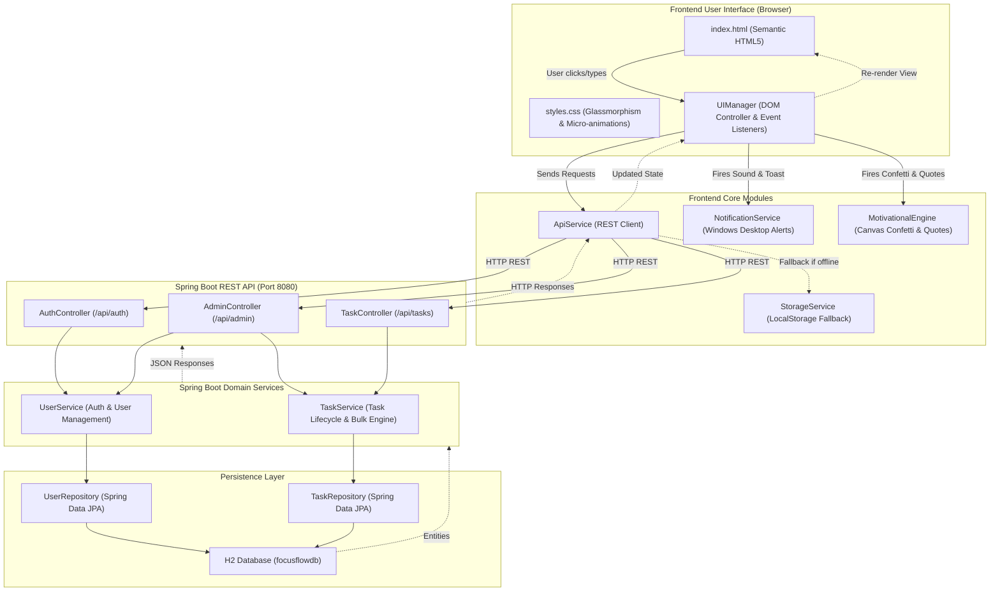

# FocusFlow — Smart Task Management Suite

> A modern, responsive Task Management Web Application with a **Spring Boot 3 (Java 17)** backend, persistent **H2 database**, multi-user isolation, administrative oversight, bulk operations, live timers, Windows desktop alerts, and celebratory motivational feedback.

---

## 🌟 Key Features

1. **Single & Bulk Task Management:**
   - Add individual tasks with custom priority, description, and reminders.
   - **Bulk Add:** Paste multiple lines of tasks at once. Supports individual inline tags like `[High] Deploy code` or `[Low] Clean cache`.
   - **Bulk Actions:** Multi-select tasks using checkboxes to start, pause, complete, or delete in batches.
2. **Start, Pause, and End Task Lifecycle:**
   - Real-time time tracking with live dynamic counter (`⏱ 04:12`) for active tasks.
   - Pause tasks to take a break without losing accumulated focus time.
   - Complete/End tasks to freeze duration and log completion timestamps.
3. **Celebrations & Motivational Quotes:**
   - Interactive 60fps **Canvas Confetti fireworks explosion** on task completion.
   - Celebratory quotes and congratulatory fanfare chime when finishing tasks.
   - Restful, encouraging quotes when pausing tasks to prevent burnout.
4. **Native Windows Desktop Notifications:**
   - Web Notification API integration triggers Windows 10/11 Action Center banner alerts when tasks are started, paused, completed, or when scheduled reminder times arrive.
   - Background interval scanner checks for due task reminders and sounds an audio chime.
5. **Multi-User Scoping & Authentication:**
   - Distinct workspaces per user ID. Tasks are private to the logged-in user.
   - Password-verified credential authentication for all users and administrators.
6. **Administrator Control Console:**
   - Admins can view all registered users, add new users with custom roles, and delete accounts (with safe cascade deletion of user tasks).
   - Cross-user task directory allows admins to monitor, filter, and delete tasks across the entire system.
7. **Dual-Mode Architecture:**
   - **Spring Boot Mode:** Full RESTful backend with Spring Data JPA & H2 persistence (`http://localhost:8080`).
   - **Standalone Mode:** Zero-dependency, offline-ready fallback using `localStorage`.

---

## 🏗️ Architectural Flow of Code



---

## 🧩 Deep Dive: Classes & How They React with the UI

### 1. Frontend JavaScript Architecture

| Class / Module | File Path | Role & How It Reacts with the UI |
| :--- | :--- | :--- |
| **`UIManager`** | [`js/ui.js`](file:///d:/AI%20Projects/To%20Do%20List/js/ui.js) | **Primary UI Coordinator.** Binds all click, input, and modal events. Renders task cards with status badges and priority tags. Runs a 1-second interval loop that dynamically updates active task timers (`⏱ 04:12`) in real-time. Toggles the floating bulk actions bar when checkboxes are selected. |
| **`ApiService`** | [`js/api.js`](file:///d:/AI%20Projects/To%20Do%20List/js/api.js) | **Backend HTTP Bridge.** Dispatches asynchronous `fetch()` requests to Spring Boot endpoints (`/api/auth`, `/api/tasks`, `/api/admin`). Attaches `X-User-Id` and `X-User-Role` headers to ensure user-scoped data. |
| **`NotificationService`** | [`js/notifications.js`](file:///d:/AI%20Projects/To%20Do%20List/js/notifications.js) | **Windows Desktop Notification Provider.** Interacts with `window.Notification` to request permissions and push native Windows 10/11 toasts. Generates synthesized audio chimes via the browser Web Audio API (`AudioContext`). Runs a background scanner to fire alerts when task reminder times match the system clock. |
| **`MotivationalEngine`** | [`js/motivation.js`](file:///d:/AI%20Projects/To%20Do%20List/js/motivation.js) | **Celebration & Encouragement Engine.** Houses a custom physics-driven Canvas particle simulator that shoots colorful confetti across the screen when tasks complete. Serves randomized inspirational quotes for task pauses and completions. |
| **`AuthManager`** | [`js/auth.js`](file:///d:/AI%20Projects/To%20Do%20List/js/auth.js) | **Session State Holder.** Keeps track of the currently logged-in user profile, role privileges (`admin` vs `user`), and broadcasts authentication changes to re-render the view. |
| **`TaskManager`** | [`js/task.js`](file:///d:/AI%20Projects/To%20Do%20List/js/task.js) | **Domain Business Logic.** Manages task state transitions (`not-started` → `running` → `paused` → `completed`), calculates live elapsed durations, handles multi-line bulk task parsing, and computes dashboard metrics. |
| **`StorageService`** | [`js/storage.js`](file:///d:/AI%20Projects/To%20Do%20List/js/storage.js) | **Local Persistence Fallback.** Provides resilient local storage caching with pre-configured demo seed accounts if running without an active backend. |

---

### 2. Spring Boot Backend Architecture

| Class | Package / Path | Responsibility & Interaction |
| :--- | :--- | :--- |
| **`FocusFlowApplication`** | [`com.focusflow`](file:///d:/AI%20Projects/To%20Do%20List/src/main/java/com/focusflow/FocusFlowApplication.java) | The Spring Boot entry point (`@SpringBootApplication`) that boots up the embedded server. |
| **`User`** | [`com.focusflow.model.User`](file:///d:/AI%20Projects/To%20Do%20List/src/main/java/com/focusflow/model/User.java) | JPA Entity representing user credentials, display name, account role (`admin` or `user`), and creation timestamp. Mapped to the `users` table. |
| **`Task`** | [`com.focusflow.model.Task`](file:///d:/AI%20Projects/To%20Do%20List/src/main/java/com/focusflow/model/Task.java) | JPA Entity representing tasks. Tracks `userId`, `title`, `description`, `priority`, `status`, `startedAt`, `elapsedSeconds`, and `reminderTime`. |
| **`UserRepository`** | [`com.focusflow.repository.UserRepository`](file:///d:/AI%20Projects/To%20Do%20List/src/main/java/com/focusflow/repository/UserRepository.java) | Spring Data JPA repository for user CRUD operations and query lookups by username. |
| **`TaskRepository`** | [`com.focusflow.repository.TaskRepository`](file:///d:/AI%20Projects/To%20Do%20List/src/main/java/com/focusflow/repository/TaskRepository.java) | Spring Data JPA repository for task CRUD, user-filtered task queries, and cascade deletions. |
| **`UserService`** | [`com.focusflow.service.UserService`](file:///d:/AI%20Projects/To%20Do%20List/src/main/java/com/focusflow/service/UserService.java) | Business service handling credential validation, new account registration, and safe deletion of user accounts with cascading task cleanup. |
| **`TaskService`** | [`com.focusflow.service.TaskService`](file:///d:/AI%20Projects/To%20Do%20List/src/main/java/com/focusflow/service/TaskService.java) | Core business engine handling: <ul><li>Single & bulk task creation</li><li>State transitions: `startTask` (sets start timestamp), `pauseTask` (accumulates elapsed time), and `endTask` (stops timer and marks completed)</li><li>Bulk status updates and bulk deletions</li><li>Dashboard metric aggregation</li></ul> |
| **`AuthController`** | [`com.focusflow.controller.AuthController`](file:///d:/AI%20Projects/To%20Do%20List/src/main/java/com/focusflow/controller/AuthController.java) | REST Controller exposing `/api/auth/login` and `/api/auth/register` to authenticate client sessions. |
| **`TaskController`** | [`com.focusflow.controller.TaskController`](file:///d:/AI%20Projects/To%20Do%20List/src/main/java/com/focusflow/controller/TaskController.java) | REST Controller exposing endpoints for task retrieval, creation, bulk operations, status transitions, and metrics. Reads user context via HTTP headers. |
| **`AdminController`** | [`com.focusflow.controller.AdminController`](file:///d:/AI%20Projects/To%20Do%20List/src/main/java/com/focusflow/controller/AdminController.java) | Administrative REST controller exposing `/api/admin/users` and `/api/admin/tasks`. Requires admin role to access. |
| **`CorsConfig`** | [`com.focusflow.config.CorsConfig`](file:///d:/AI%20Projects/To%20Do%20List/src/main/java/com/focusflow/config/CorsConfig.java) | Configures Cross-Origin Resource Sharing (CORS) and static file serving from `classpath:/static/`. |
| **`DataInitializer`** | [`com.focusflow.config.DataInitializer`](file:///d:/AI%20Projects/To%20Do%20List/src/main/java/com/focusflow/config/DataInitializer.java) | Auto-seeds default administrative and demo accounts upon application startup. |

---

## 🚀 How to Run the Application

### Option A: Run with Spring Boot Backend (Recommended)

1. **Verify Prerequisites:**
   - Java 17+ installed (`java -version`)
   - Apache Maven installed (`mvn -version`)

2. **Start the Spring Boot Server:**
   Open a terminal in the project directory (`d:\AI Projects\To Do List`) and run:
   ```bash
   mvn spring-boot:run
   ```

3. **Open the App in Your Browser:**
   Navigate to:
   ```
   http://localhost:8080
   ```

4. **Access the H2 Database Console (Optional):**
   - URL: `http://localhost:8080/h2-console`
   - JDBC URL: `jdbc:h2:file:./data/focusflowdb`
   - Username: `sa`
   - Password: *(leave blank)*

---

### Option B: Run Standalone Frontend Directly

You can also directly open [`index.html`](file:///d:/AI%20Projects/To%20Do%20List/index.html) in any modern browser (Chrome, Edge, Firefox, Brave) without running Maven. The application will automatically operate using local storage persistence.

---

## 🔑 Accounts & Authentication

Every user must provide their specific username and password to log in. To test the system, you can use the pre-seeded accounts below or register a brand-new account using the **Create Account** tab:

| Username | Password | Role | Description |
| :--- | :--- | :--- | :--- |
| `demo` | `demo123` | **User** | Standard account with pre-loaded active, paused, and completed tasks. |
| `admin` | `admin123` | **Admin** | Full system administrator. Can access the Admin Panel, manage users, and oversee all system tasks. |

> **Security Note:** All logins strictly require entering valid password credentials. To switch accounts, click **Log Out** in the top navigation bar and log in with the new account's credentials.

---

## 🔔 Enabling Windows Desktop Notifications

1. Click the **"Windows Alerts"** button in the top navigation header.
2. In the browser permission prompt, select **"Allow"**.
3. You will receive an immediate native confirmation alert. FocusFlow will now deliver native Windows notifications whenever you start, pause, complete, or trigger a task reminder!
